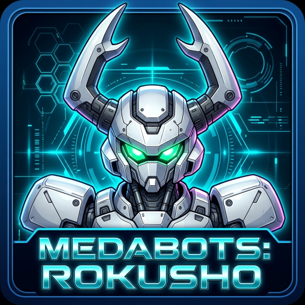

# Medabots NX (`medabots-nx`) - Dual Edition

> **Nintendo Switch Homebrew Port**  
> Ported and optimized for the Nintendo Switch by **Niecks90** (v0.2.0).

Native static recompilation port of both **Medabots: Rokusho Version** and **Medabots: Metabee Version** (Game Boy Advance) for the **Nintendo Switch**, powered by the [GBARecomp](https://github.com/Mr-Wiseguy/gbarecomp) framework and matching de後compilation projects ([medabots-rokusho](https://github.com/medabots-re/medabots) & [medabot-decomp](https://github.com/lucasderksen/medabot-decomp)).

The game ROMs and Nintendo GBA BIOS are **not included**. You must provide your own legally dumped copies.

---

<p align="center">
  
</p>

---

## What's New in v0.2.0

- **Dual-Version Support in a Single NRO**: Switch seamlessly between **Medabots: Rokusho** and **Medabots: Metabee** with automatic ROM detection at boot.
- **Independent Save Management**:
  - `save/rokusho.sav` for Rokusho Version.
  - `save/metabee.sav` for Metabee Version.
  - Existing `save/rom.sav` from v0.1.0 is automatically migrated to `save/rokusho.sav` on first launch with zero progress loss.
- **Dynamic Dispatch Architecture**: All 80,000+ statically recompiled native functions from both versions co-exist without symbol collisions.
- **Interactive Error / Verification Screens**: If a ROM is missing or invalid, an informative error screen lists the supported SHA-1 hashes and exact file names.

---

## Features

- **Native AArch64 Execution**: Statically recompiled directly to native 64-bit ARM machine code, running at a rock-solid 60 FPS with minimal CPU load and maximum battery life.
- **Pixel-Perfect 4:3 Presentation**: Authentic integer-scaled display preserving the original aspect ratio without distortion or stretching.
- **Discreet On-Screen FPS Counter**: Clean semi-transparent pill overlay in the top-right corner, completely outside the 4:3 gameplay frame.
- **Live FPS Toggle (R3)**: Click the **Right Stick (R3)** at any moment to toggle the FPS display on or off.
- **Rear Triggers Support (ZL / ZR)**: Ergonomic mapping for Switch controllers: ZL acts as L and ZR acts as R.
- **Clean Homebrew Exit**: Hold **+ (Start)** and **- (Select)** simultaneously to quit safely back to the Homebrew Menu.
- **Configurable Settings**: Customizable via `sdmc:/switch/medabots_nx/config.txt` (audio, vsync, CPU boost, bilinear filter, FPS counter).

---

## Installation & SD Card Layout

1. Download `medabots-nx-v0.2.0.zip` (or `medabots_nx.nro`) from the [Latest Release](https://github.com/Niecks90/medabots-nx/releases).
2. Extract or copy the `medabots_nx` folder into `/switch/` on your microSD card:
   ```
   sdmc:/switch/medabots_nx/
   ```
3. Place your legally dumped game ROMs in `sdmc:/switch/medabots_nx/`:
   - For **Rokusho Version**: name the file `rokusho.gba` (or `rom.gba`)
     - Size: `8,388,608` bytes (8 MB)
     - SHA-1: `c4572428ea97b302f699a3b4eba2a1f0e87c1c9c` (USA)
     - CRC32: `0xe144ded2`
   - For **Metabee Version**: name the file `metabee.gba`
     - Size: `8,388,608` bytes (8 MB)
     - SHA-1: `cd3d674e88f40a0707b150c4293588a659001d29` (Europe) or `fee2d1db994e1a13fc2bc9943198136192412185` (USA)
     - CRC32: `0x50927f3e` (Europe)
   *(If both ROMs are present, `rokusho.gba` is loaded by default. Rename the one you want to play or keep just the active version's ROM in the folder).*
4. Place your dumped GBA BIOS named `gba_bios.bin`:
   - Exact Size: `16,384` bytes
   - SHA-1: `300c20df6731a33952ded8c436f7f186d25d3492`
5. Example SD card layout:
   ```text
   /switch/medabots_nx/
    ├── medabots_nx.nro       (The game executable)
    ├── rokusho.gba           (Medabots: Rokusho Version ROM)
    ├── metabee.gba           (Medabots: Metabee Version ROM)
    ├── gba_bios.bin          (Retail GBA BIOS)
    ├── config.txt            (Optional config file, auto-generated on first boot)
    └── save/
         ├── rokusho.sav      (Auto-created save data for Rokusho)
         └── metabee.sav      (Auto-created save data for Metabee)
   ```

> [!TIP]
> For optimal stability and access to full system RAM, launch this homebrew using **Title Override** (hold `R` while launching any installed game from the Switch main menu) rather than Applet Mode (Album).

---

## Controls

| Switch Button | Action |
|---|---|
| **D-Pad / Left Stick** | Character Movement & Menu Navigation |
| **A** | Confirm / Interact / Speak |
| **B** | Cancel / Run / Back |
| **L / ZL** | Open Medawatch / Quick Status |
| **R / ZR** | Robattle Stats / Info |
| **+ (Start)** | Field Menu / Pause |
| **- (Select)** | Robattle Log / Submenu |
| **R3 (Right Stick Click)** | **Toggle FPS Counter on/off** |
| **+ and - Held Together** | **Exit cleanly to Homebrew Menu** |

---

## Configuration (`config.txt`)

On first launch, `config.txt` is automatically created in `sdmc:/switch/medabots_nx/config.txt`:

```ini
vsync = 0
uncapped = 0
cpu_boost = 0
linear_filter = 0
show_fps = 1
audio = 1
```

### Options:

* `show_fps` (`1` or `0`): Displays the live FPS pill counter in the top-right corner.
* `audio` (`1` or `0`): Enables or disables sound output.
* `vsync` (`0` or `1`): `0` uses the low-latency frame pacer (recommended). `1` locks presentation to the Switch display refresh.
* `cpu_boost` (`0`, `1`, or `2`): `0` is the default balanced frequency (1020 MHz).
* `linear_filter` (`0` or `1`): `0` for pixel-crisp nearest neighbor (recommended), `1` for bilinear filtering.

---

## Building from Source

Building requires Linux with [devkitPro](https://devkitpro.org/) and the `devkitA64` toolchain installed:

```bash
# 1. Clone repository recursively
git clone --recursive https://github.com/Niecks90/medabots-nx.git
cd medabots-nx

# 2. Place clean matching ROMs
cp /path/to/medabots_rokusho.gba decomp/baserom.gba
cp /path/to/medabots_metabee.gba decomp_metabee/baserom.gba

# 3. Generate static recompilation shards for both versions
./generator.sh

# 4. Build Nintendo Switch NRO
./build_switch.sh
```

The resulting `medabots_nx.nro` will be output in `build/`.

---

## Copyright & Legal Disclaimer

* This project is an unofficial, non-commercial fan-made port for preservation and educational purposes.
* **No copyrighted files, proprietary assets, game ROMs, or BIOS binaries are contained within this repository or its releases.**
* All trademarks, game titles, characters, and assets are property of their respective owners:
  - **Medabots** is a registered trademark of Imagineer Co., Ltd., Natsume Inc., Nelvana, and Kodansha.
  - **Nintendo Switch** and **Game Boy Advance** are registered trademarks of Nintendo Co., Ltd.
